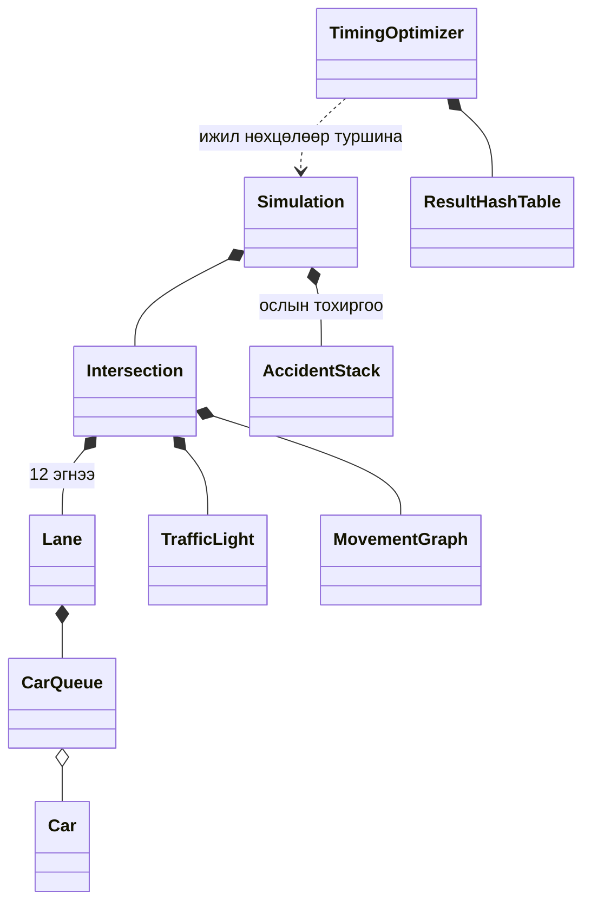

# DSA221 · Замын хөдөлгөөний симуляц

Дөрвөн чиглэлтэй уулзварын автомашины урсгал, дараалал, гэрлэн дохиог нэг секундтэй тэнцэх алхмаар загварчлах өгөгдлийн бүтцийн төсөл.

**Хувилбар B · C# · Консол програмын загвар**

## Эхний дизайн

Машин дугаар, ирсэн алхам, явах чиглэлээ хадгална. Нэвтрэх алхмаас ирсэн алхмыг хасаж хүлээлгийн хугацааг тооцно.

Симуляцын нэг алхам нь нэг секундтэй тэнцэнэ.

1. Чиглэл бүрийн ирэх магадлалаар шинэ машин нэмэх эсэхийг шийднэ. Гараар нэмсэн машиныг мөн тухайн чиглэлийн дараалалд оруулна.
2. Гэрлэн дохионы үлдсэн хугацааг нэгээр багасгаж, хугацаа дуусвал төлөвийг солино.
3. Ногоон гэрэлтэй чиглэлийн дарааллаас машин нэвтрүүлнэ.
4. Чиглэл тус бүрийн нэвтэрсэн болон хүлээж буй машины тоо, хүлээлгийн хугацааг шинэчилнэ.

Ижил тохиргоо, seed болон гараар оруулсан ижил үйлдлүүдээр симуляцыг давтахад үр дүн ижил байх ёстой.

### Өгөгдлийн бүтцийн сонголт

| Бүтэц | Хаана, яагаад ашиглах вэ? |
| --- | --- |
| Холбоост жагсаалтаар хийсэн Queue | Орох чиглэл бүрийн эгнээнд нэг дараалал байна. Эгнээ тус бүрт түрүүлж ирсэн машин түрүүлж нэвтэрнэ. Толгой, сүүлээ хадгалснаар хоёр үйлдэл хоёулаа тогтмол хугацаатай. |
| Graph | Орох, гарах чиглэлүүдийг оройгоор, зөвшөөрөгдсөн эргэлт болон шулуун хөдөлгөөнийг ирмэгээр дүрсэлнэ. Ослын үед тухайн чиглэлийн хөдөлгөөнийг түр хааж, гэрлэн дохио нээлттэй чиглэлийг сонгоно. |
| Stack | Симуляцыг ажиллуулахаас өмнө нэмсэн ослын тохиргоог хадгална. Хэрэглэгч алдаатай тохиргоог сүүлд оруулснаас нь эхэлж буцааж болно. |
| Hash Table | Хугацааны оновчлолоор туршсан тохиргоо болон үр дүнг хадгална. Ижил нөхцөл, ижил хугацааны тохиргоог дахин тооцохоос өмнө үр дүнг түлхүүрээр хайна. |

### Нэмэлтүүд

1. **№7 Ослын нөхцөл (12 оноо, B хувилбарын заавал хийх нэмэлт).** Сонгосон чиглэлийг өгсөн алхмаас эхлэн тодорхой хугацаанд хаана. Тэнд хүлээж буй машинууд дараалалдаа үлдэнэ. Бусад чиглэл үргэлжлэн ажиллаж, хугацаа дуусахад хаасан чиглэл дахин нээгдэнэ.
2. **№5 Хугацааны оновчлол (12 оноо).** Ижил seed, машины ирэлтийн магадлал, алхмын тоо болон ослын хуваариар өөр өөр ногоон хугацааг туршина. Дундаж хүлээлгийн хугацааг нэвтэрсэн болон туршилтын төгсгөлд үлдсэн машины тоотой хамт харьцуулна.
3. **№8 Эгнээ, чиглэл сонгох (8 оноо).** Орох чиглэл бүрт шулуун, баруун, зүүн эргэх тусдаа эгнээ байна. Машин зорчих эгнээндээ дараалалд орно. Чиглэл ослоор хаагдвал гурван эгнээнээс нь машин нэвтрүүлэхгүй.

### Класс диаграмын ноорог

## AI ашигласан тэмдэглэл

Codex-ийг GitHub репог шалгах, Git-ийн тохиргоо, README, нэмэлтүүдийн сонголт болон класс диаграмын нооргийг бэлтгэхэд ашигласан.
